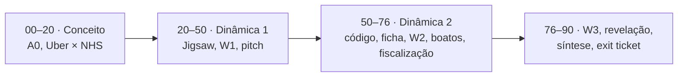

# Fluxo paralelo: professor × estudantes (T35 · 90 min)

Mesma linha do tempo do `master-roteiro.md`. Coluna da esquerda: o que o professor faz. Coluna da direita: o que as mesas fazem.

## Antes da aula

| Professor | Estudantes |
| :--- | :--- |
| Abrir `professor/painel-professor.html`, sortear as posturas e anotar | Ler os autoestudos 1 a 4 |
| Imprimir 5 envelopes (`professor/cartoes-ceo.md`) | — |
| Testar `alunos.html` no projetor e anotar os 5 códigos | — |
| Preparar no Miro um frame por mesa (A0, W1, W2, W3) | — |

## Parte 1 · Conceito (00–20)

| Min | Professor | Estudantes |
| :--- | :--- | :--- |
| 00–05 | Abre a aula e mostra o objetivo | Ouvem |
| 05–12 | Conduz o debrief da Aurora | Colam stickies no A0: acerto e ponto cego |
| 12–20 | Contrasta Uber 2016 × NHS 2017; apresenta a legenda de cores | Perguntam e anotam |

## Parte 2 · Dinâmica 1 (20–50)

| Min | Professor | Estudantes |
| :--- | :--- | :--- |
| 20–25 | Forma as mesas (um de cada G1–G5 + fiscal cruzado); entrega os envelopes aos CEOs | Abrem `alunos.html`, escolhem a mesa e os papéis |
| 25–40 | Circula cobrando autoridade única de parada e prazos explícitos | Preenchem o W1 sem modelo pronto |
| 40–50 | Cronometra 5 pitches de 1,5 min | Apresentam risco, autoridade de parada e regulador mais exigente |

## Parte 3 · Dinâmica 2 (50–82)

| Min | Professor | Estudantes |
| :--- | :--- | :--- |
| 50–52 | Anuncia o código de cada mesa | Digitam o código e abrem a ficha do setor |
| 52–70 | Observa a negociação; lê o boato do setor aos **58** e aos **66 min** | Triagem (fato, hipótese, lacuna), decisões no W2; CEO segue o envelope |
| 70–76 | Circula e anota | O 6º integrante fiscaliza a mesa seguinte; a mesa responde com evidências |
| 76–82 | Cobra os 4 requisitos de cada ação | Registram 2 ações + 1 controle e os 5 aceites |

## Fechamento (82–90)

| Min | Professor | Estudantes |
| :--- | :--- | :--- |
| 82–85 | Pede aos CEOs que revelem os envelopes; compara Ocultação × Transparência | Contam onde cederam ou resistiram |
| 85–88 | Síntese: protocolo antes do evento; decisão técnica, legal e humana ao mesmo tempo; evidência como defesa | Ouvem |
| 88–90 | Recolhe os arquivos | Exit ticket; exportam dossiê (.txt) e W2 (.csv) e enviam ao professor |

## Coleta das decisões

Cada mesa exporta dois arquivos pela página: o dossiê completo (`Dossie-WarRoom-MCx-T35.txt`) e a tabela do W2 (`W2-MCx-T35.csv`, separada por ponto e vírgula, abre no Excel). Se o download estiver bloqueado, a página copia o dossiê para a área de transferência, para colar no Miro ou no Slack.
